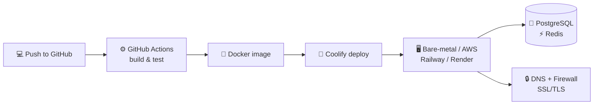

<p align="center">
  
</p>

<p align="center">
  <a href="https://git.io/typing-svg">
    
  </a>
</p>

<p align="center">
  <a href="https://linkedin.com/in/edehgeorge43649"></a>
  <a href="mailto:georgeedeh6565@gmail.com"></a>
  
</p>

---

## `$ whoami`

```yaml
name:      George Chinaza Edeh
role:      Lead Backend Developer @ Nanocodes
focus:     DevOps / Infrastructure Reliability / Backend Systems
based_in:  Nigeria 🇳🇬
education: B.Sc. Computer Science, University of Nigeria, Nsukka
currently:
  - Provisioning production services with Docker + Coolify
  - Running PostgreSQL & Redis in live systems
  - Hardening servers: DNS, firewalls, SSL/TLS
  - Automating releases with GitHub Actions
learning:  Sharpening DevOps skills with the Upskill Space community
```

---

## 🔄 How I ship



---

## 🧰 Toolbox

<p align="center">
  
  <br/>
  
</p>

| Area | Stack |
|---|---|
| ☁️ **Infrastructure** | Docker, Docker Compose, Coolify, GitHub Actions, AWS, Railway, Render, bare-metal servers |
| 🧠 **Backend** | Python, Django, REST API design, Celery, Socket.io, JWT auth, third-party/microservice integration |
| 🗄️ **Data** | PostgreSQL, Redis |
| 🔐 **Networking & Security** | DNS management, firewall configuration, TCP/IP, SSL/TLS, API security |
| 🐧 **OS & Scripting** | Ubuntu, Bash, Python, JavaScript |

---

## 🚀 Things I've built

<table>
  <tr>
    <td width="50%" valign="top">
      <h3>🧾 <a href="https://saletick.net">Saletick</a></h3>
      <p>Inventory and sales management for small Nigerian retailers, run entirely through <b>WhatsApp</b>.</p>
      <ul>
        <li>Log sales by text, voice or barcode</li>
        <li>Real-time inventory tracking</li>
        <li>Instant invoicing</li>
        <li>Live reports on sales, stock and profit trends</li>
      </ul>
    </td>
    <td width="50%" valign="top">
      <h3>🎓 <a href="https://myrabbai.tus-e.com">MyRabbai</a></h3>
      <p>AI-powered personalized learning platform.</p>
      <ul>
        <li>Intelligent content delivery</li>
        <li>Interactive learning paths</li>
        <li>Progress tracking</li>
      </ul>
    </td>
  </tr>
</table>

---

## 📈 Track record

| | |
|---|---|
| ⚡ **20%** | faster response times after moving heavy work to async processing with Celery |
| 🔌 **15+** | RESTful API endpoints shipped to production |
| 👀 **30%** | more efficient code reviews after introducing coding standards |
| 🖥️ **350+** | IT assets and licenses audited and managed during my IT support internship |

---

## 📊 GitHub activity

<p align="center">
  
  
</p>

<p align="center">
  
</p>

---

<p align="center">
  <i>"If it isn't monitored, documented and automated, it isn't finished."</i><br/><br/>
  <a href="mailto:georgeedeh6565@gmail.com">georgeedeh6565@gmail.com</a> ·
  <a href="https://linkedin.com/in/edehgeorge43649">LinkedIn</a>
</p>


